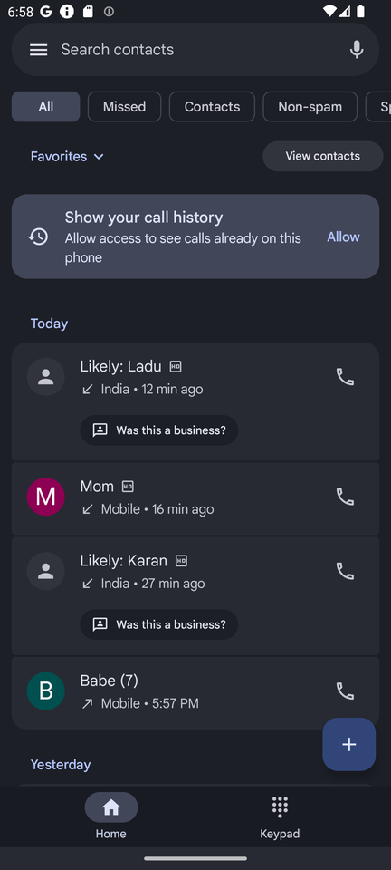
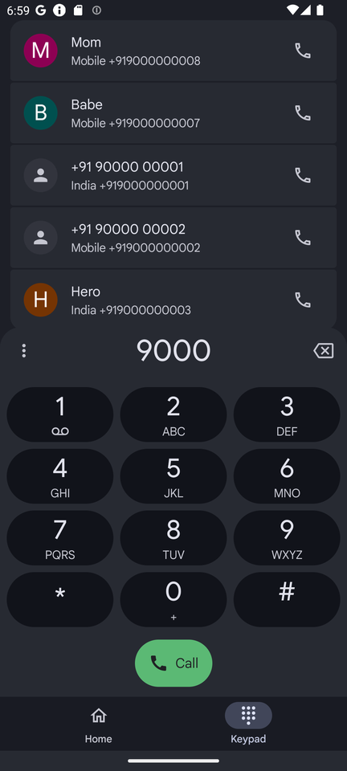
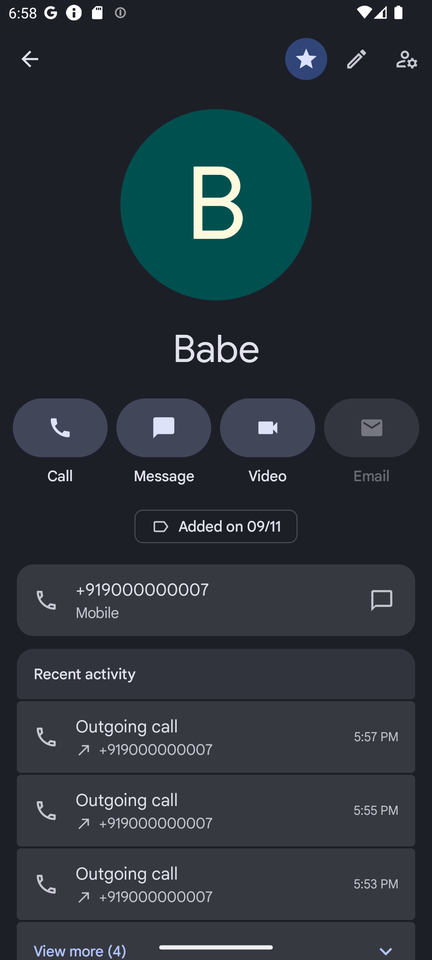
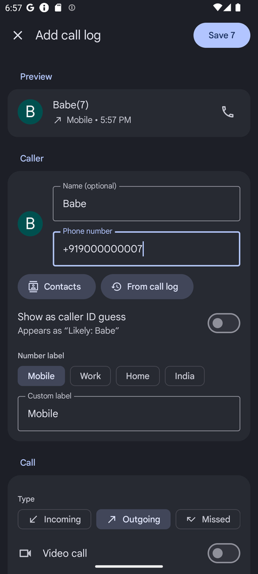
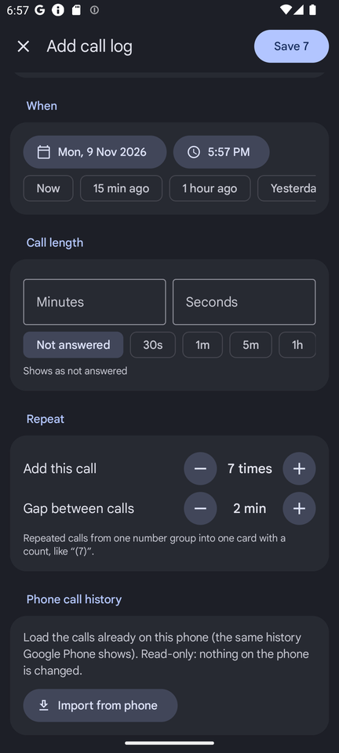
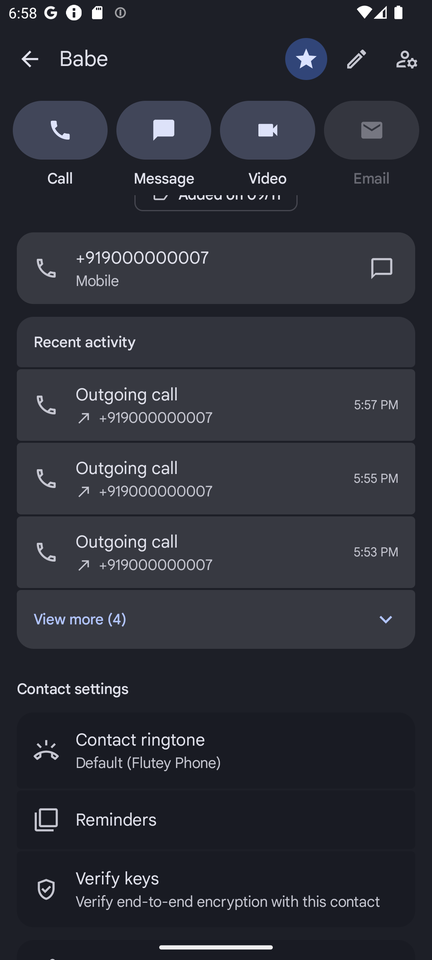
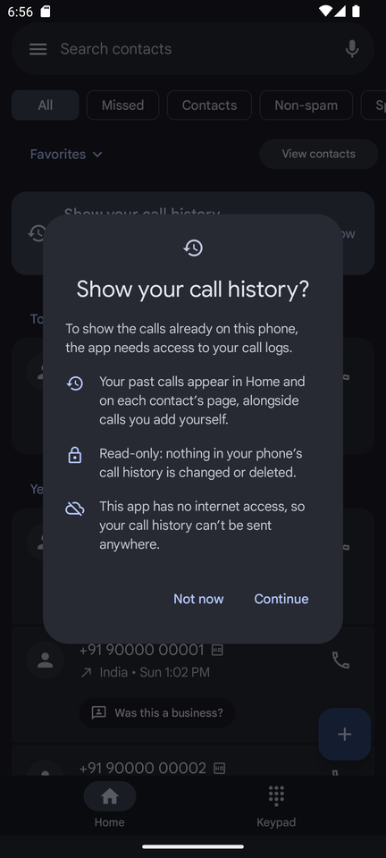

# Google Dialer replica

A Jetpack Compose replica of the Google Phone (dialer) app's call history, keypad and contact page, with Material You
dynamic colors. On top of the look-alike UI it can load your phone's real call history and, the star of the show,
**lets you add call logs that never happened.**

> Not affiliated with or endorsed by Google. It's a UI replica: it doesn't place calls itself (the Call buttons
> hand the number to your phone's dialer), and it never changes your real call history.

<p align="center">
  
  
  
</p>

## ⭐ Add call logs: your alibi, generated

*"I called you like 7 times, babe! Look!"*

We've all been there. You promised to call. You did not call. Now there's a very specific silence on the other end
of the chat. This is what the **+** button is for.

<p align="center">
  
  
  
</p>

| The situation | The recipe |
| --- | --- |
| 💔 *"You didn't even try to call me."* | **Babe**, Outgoing, Not answered, *1 hour ago*, repeat **7 times**, 2 min apart. Home now shows **Babe (7)**. Desperate, devoted, unanswered. |
| 👩 *"You never call your mother."* | **Mom**, Incoming, call length **1h**. A whole hour. You listened to everything about the neighbour's renovation. |
| 👨 *"I tried calling you, why was your phone off?"* | **Papa**, Missed, *Yesterday*, repeat 3 times. Clearly the network's fault. |
| 🧑‍💼 *"Did you call the client back?"* | **Client**, label **Work**, Outgoing, **5m**, HD on. Very professional. Very HD. |
| 🕵️ *"Who is this mystery number?"* | Leave the name blank and turn on **Show as caller ID guess**: *Likely: Pizza Guy*. Plausible deniability, built in. |
| 📸 *Need a screenshot full of activity* | **Quick fill → Generate 50 calls**: a busy, believable week in one tap. |

> **Honest fine print:** these calls live only inside this app. They don't show up in your phone's real dialer or
> the carrier's records, so they'll hold up in a screenshot, not in an investigation. Use for jokes, demos and
> design mock-ups, and maybe also just call your mom.

### What you can set

The form is full screen, with a **live preview** at the top showing exactly how the card will look on Home.

- **Caller:** name (optional, so blank = unknown number), phone number, or pick one from your **Contacts** or from
  numbers already **in the call log**
- **Caller ID guess:** shows the name as *"Likely: Name"*, the way the real app does for unsaved numbers
- **Number label:** Mobile, Work, Home, India, or type your own
- **Call type:** Incoming, Outgoing, Missed, Declined, Blocked, Voicemail
- **Extras:** video call, HD voice badge, SIM 1 / SIM 2
- **When:** any date and time, or one tap: *Now*, *15 min ago*, *1 hour ago*, *Yesterday*, *Last week*
- **Call length:** minutes and seconds, or *Not answered*, *30s*, *1m*, *5m*, *1h*
- **Repeat:** add the same call up to 20 times with a gap of 1–120 minutes between them. They group into one card
  with a count, like **(7)**
- **Quick fill:** generate 5–50 random calls over the last week, mixing your existing names with unknown numbers

Saved calls show up everywhere: Home, filters, keypad suggestions and the contact page. Tap a card and hit
**Delete** to remove them again, or delete a whole number's history from its contact page.

## Features

**Home (call history)**
- Search bar, filter chips (All, Missed, Contacts, Non-spam, Spam) and Favorites row
- Calls grouped into Today / Yesterday / Older, with repeated calls from one number merged into one card with a
  count, like `(3)`
- Tap a card to expand it (each call's date, time and length, plus Delete); tap an avatar to open the contact page
- Badges for HD, video calls and SIM 1 / SIM 2; icons for incoming, outgoing, missed, declined, blocked and voicemail

**Keypad**
- Slide-up dialpad with DTMF tones and haptics, auto-shrinking number display, pause/wait menu
- Matching numbers from your history while you type, plus Create new contact, Add to a contact, Video call and
  Send a message
- Call with an empty number refills the last number you dialed

**Contact page** (replica of the Contacts card Google Phone opens)
- Saved and unknown-number layouts, collapsing header with the title moving into the toolbar, pinned action buttons
- Recent activity shows the 3 newest calls, with **View more / View less**
- Contact settings: ringtone, block, delete call history for that number, and more

**Add call log** (the + button): see [above](#-add-call-logs-your-alibi-generated)

**Your phone's call history**

<p align="center">
  
</p>

- On first start the app explains why it wants call-log access, then shows Android's permission prompt
- Once allowed, your whole history is loaded (with a loading indicator), and new calls are picked up every time
  you return to the app
- Read-only: nothing in the phone's real call log is changed or deleted. The app has no internet permission.
- If you deny, the app keeps working with only the calls you add yourself. An **Allow** card on Home and an
  **Import from phone** button on the Add call log page let you grant access later; if Android won't ask again,
  they take you to the app's settings.

## Building

Requirements: Android Studio (recent), JDK 17+, Android SDK with API 37.

```bash
./gradlew :app:assembleDebug
./gradlew :app:installDebug
```

Unit tests (grouping, labels, generators, import mapping):

```bash
./gradlew :app:testDebugUnitTest
```

Min SDK 26 (Android 8.0). Dynamic colors need Android 12+; older versions use a built-in teal dark theme.

## Project layout

All code is in `app/src/main/java/com/dialer/calllogmaker/`:

| File | What's in it |
| --- | --- |
| `MainActivity.kt` | Entry point |
| `HomeScreen.kt` | App shell (tabs, overlays, call-log permission flow) and the call history tab |
| `KeypadScreen.kt` | Keypad tab and dialpad |
| `ContactScreen.kt` | Contact page |
| `AddCallLogScreen.kt` | Add call log form |
| `CallLog.kt` | Call model, grouping/label helpers, random generator, storage |
| `PhoneCallLog.kt` | Reads the phone's call history |
| `CallLogPermission.kt` | Permission explanation, denied dialog and Allow card |
| `ui/theme/` | Colors, dynamic color theme and typography |

Call logs are stored in the app's SharedPreferences as JSON. Imported calls keep the phone's row id (stored as a
negative id), so importing twice never creates duplicates.

## Fonts

`app/src/main/res/font/` contains Google Sans and Google Sans Text, which are Google's fonts. They aren't
open-source. To use an open font instead, swap them for [Google Sans Flex](https://github.com/google/fonts/tree/main/ofl/googlesansflex)
(SIL Open Font License) in `ui/theme/Type.kt`.
